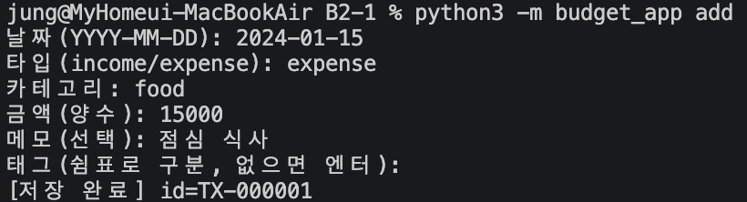
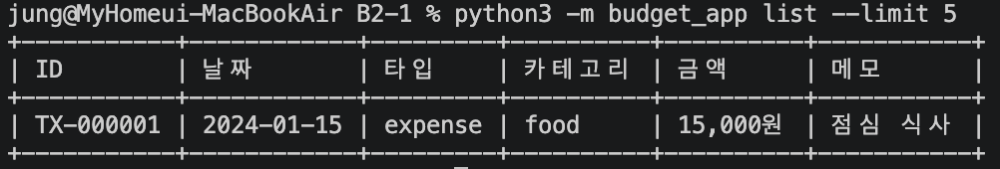
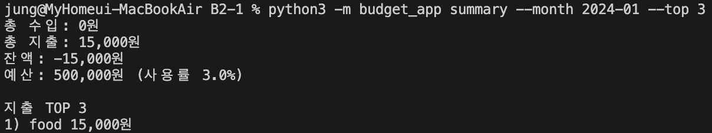
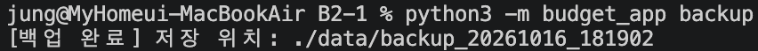
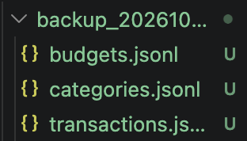
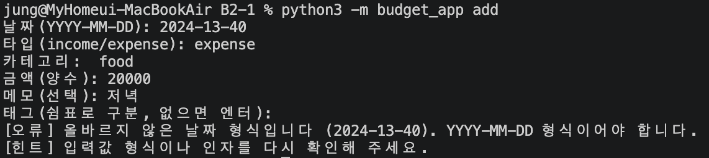
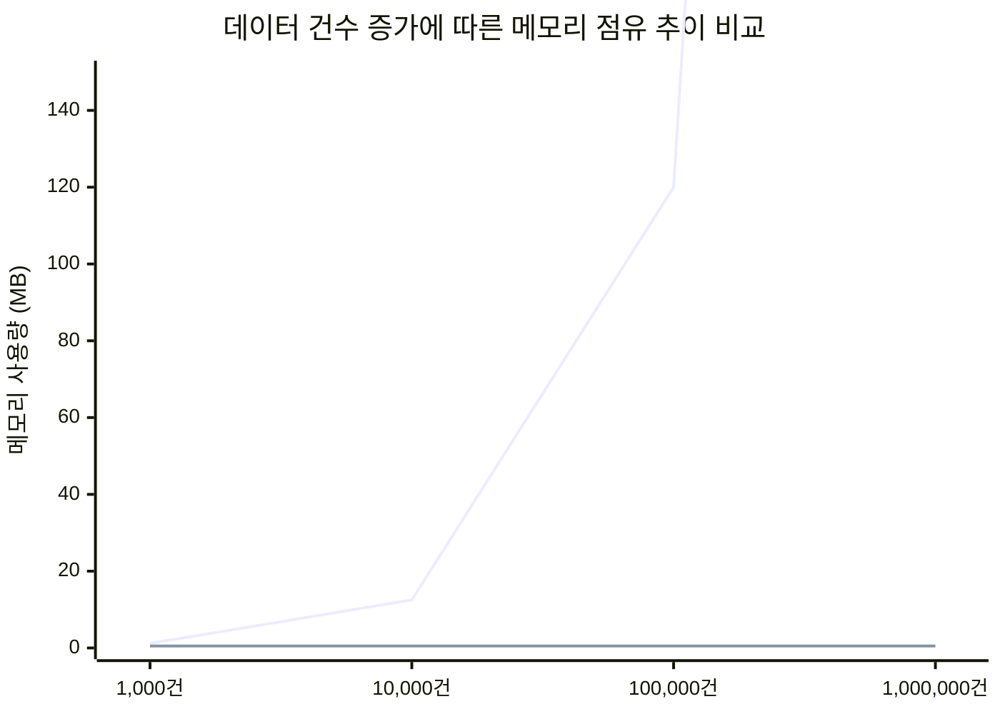

# 나만의 용돈 기입장 프로그램 만들기
`Python 기초 문법, 제너레이터 기반 스트리밍 I/O, 임시 파일 및 atomic replace 기반 데이터 안정성, 공통 데코레이터 분리, 타입 힌트, 모듈화 설계 및 보너스 과제(백업, 반복 내역, 표 정렬)를 적용한 터미널 기반 영구 저장 가계부 프로젝트입니다.`

## 1. 프로젝트 개요 및 과제 목표
- 프로젝트명: Budget App (Console Financial Tracker)

- 개발 환경: Python 3.10+ (macOS / Linux 환경, 표준 라이브러리만 사용)

- 주요 목표:
    - 파일 입출력 기반의 영구 저장 기능(JSONL)으로 가계부 CRUD, 조건 검색, 월별 요약, CSV 가져오기/내보내기 구현

    - 제너레이터(`yield`)를 활용한 대용량 파일 스트리밍 처리로 메모리 효율성 확보

    - 임시 파일 쓰기 및 원자적 교체(`os.replace`) 기반 트랜잭션 설계로 파일 쓰기 도중 예외 발생 시 데이터 파손 방지

    - 타임스탬프 기반 데이터 백업(`backup`) 및 월별 고정 수입/지출 자동 생성(`recurring`) 로직 구현

    - 외부 라이브러리 없는 동적 표 정렬 포맷터(`formatter.py`)를 통합하여 콘솔 가독성 개선

    - 데코레이터를 통한 공통 관심사(예외 처리, 시간 측정) 분리 및 사용자 친화적 오류/힌트 메시지 출력

## 2. 주제 및 선정 이유
- 주요 주제: 예외 상황에서도 데이터가 안전하게 유지되는 모듈화된 파일 기반 콘솔 가계부 애플리케이션

- 선정 이유:
    - 단순히 메모리상에서 동작하는 프로그램을 넘어, 영구 저장소 I/O 시 발생할 수 있는 동시성/파손 문제와 메모리 오버헤드를 고려한 "작은 서비스" 설계 관점을 익히기에 최적입니다.

    - CLI 계층, 비즈니스 서비스 계층, 영구 저장소 계층, 데이터 모델 계층을 분리하여 유지보수성 높은 코드 Architecture를 체득하기 위해 선정했습니다.

## 3. 실행 방법 및 설명
#### 환경 요구사항
- macOS / Linux: Python 3.10 이상 설치 필요 (`python3`)

- 외부 라이브러리(`pip3 install`) 설치 불필요 (Python 표준 라이브러리만 사용)

#### 상세 실행 단계
1. 저장소 복제 및 프로젝트 디렉터리 이동
```bash
git clone https://github.com/woochul0516/AI_Learning_Tool
cd B2-1
```

2. 프로그램 도움말 확인

`터미널에서 아래 명령어를 실행합니다`
```bash
python3 -m budget_app --help
```

3. 주요 기능별 명령 예시
- 거래 추가(add, 대화형):
```bash
python3 -m budget_app add
```

- 거래 목록 조회(list, 최신순 스트리밍 & 표 정렬):
```bash
python3 -m budget_app list --limit 5
```

- 조건 검색(search):
```bash
python3 -m budget_app search --from 2024-01-01 --to 2024-01-31 --category food
```

- 월별 요약 및 예산 확인(summary):
```bash
python3 -m budget_app summary --month 2024-01 --top 3
```

- 월 예산 설정(budget):
```bash
python3 -m budget_app budget set --month 2024-01 --amount 500000
```

- 카테고리 관리(category):
```bash
python3 -m budget_app category list
python3 -m budget_app category add --name shopping
python3 -m budget_app category remove --name food --fallback etc
```

- 거래 수정 및 삭제(update / delete):
```bash
python3 -m budget_app update --id TX-000001
python3 -m budget_app delete --id TX-000001
```

- CSV 데이터 가져오기 / 내보내기(import / export):
```bash
python3 -m budget_app export --out export.csv --month 2024-01
python3 -m budget_app import --from import.csv
```

- [보너스] 타임스탬프 데이터 백업(backup):
```bash
python3 -m budget_app backup
```

- [보너스] 반복 내역 자동 생성(recurring):
```bash
python3 -m budget_app recurring --month 2024-02
```

## 4. 기능 및 예외 처리 요구사항 구현 현황
공통 입력 및 예외 처리 기준

- 원자적 파일 교체 (Atomic File Replace):
    - 데이터 수정 및 삭제 시 임시 파일(`tempfile`)에 먼저 작성한 뒤 `os.replace`로 원자적으로 교체하여 쓰기 작업 중 비정상 종료 시에도 기존 파일 파손을 방지합니다.

- 타임스탬프 데이터 백업 (`backup`):
    - `backup` 명령어 실행 시 현시점의 타임스탬프 폴더(`backup_YYYYMMDD_HHMMSS`)를 생성하고 현재 데이터를 보존하여 복구 안정성을 확보했습니다.

- 반복 내역 자동 생성 (`recurring`):
    - 월급, 월세 등 반복되는 규칙을 기반으로 중복 생성 방지 검증을 거쳐 특정 월의 내역을 자동 일괄 생성합니다.

- 콘솔 표 정렬 포맷터 (`formatter.py`):
    - 전각/반각 문자의 가로 폭 계산 알고리즘을 구현하여 외부 라이브러리 없이 깔끔하게 정렬된 바운더리 그리드 표를 출력합니다.

- 예외 처리 및 스택트레이스 감추기:
    - `@handle_errors` 데코레이터를 적용하여 스택트레이스 노출을 차단하고, [`오류`] 원인 및 [`힌트`] 해결 가이드를 출력한 후 `sys.exit(1)`로 비정상 종료 코드를 반환합니다.

- 대용량 파일 스트리밍 처리:
    - `TransactionRepository.stream_all()` 함수에서 `yield` 제너레이터를 사용하여 전체 파일을 메모리에 일시 로드하지 않고 한 줄씩 읽어 들입니다.

## 5. 파일 구조
```text
B2-1/
├── budget_app/
│   ├── __init__.py      # 패키지 초기화 파일
│   ├── __main__.py      # python3 -m budget_app 진입점
│   ├── cli.py           # CLI 인자 파싱 및 대화형 입출력 계층
│   ├── decorators.py    # 공통 관심사(예외 처리, 시간 측정) 데코레이터
│   ├── formatter.py     # [보너스] 터미널 전각/반각 문자 폭 기준 표 정렬 모듈
│   ├── models.py        # Transaction, Budget, RecurringRule 데이터 모델
│   ├── repository.py    # JSONL 영구 저장소 I/O 및 스트리밍/원자적 쓰기
│   └── service.py       # 비즈니스 로직(검색, 요약, 백업, 반복생성 등)
└── data/                # 영구 데이터 저장 폴더 (실행 시 자동 생성)
    ├── transactions.jsonl
    ├── categories.jsonl
    └── budgets.jsonl
```

## 6. 실습 스크린샷

| 기능 구분 | 스크린샷 예시 |
| :--- | :--- |
| **거래 추가 (add)** |  |
| **목록 조회 (list)** |  |
| **월별 요약 (summary)** |  |
| **데이터 백업 (backup)** |   |
| **오류 예외 힌트 (Error Handling)** |  |

## 7. 주요 모듈 및 클래스 설계 (Architecture & Responsibilities)
1. `Transaction`, `Budget`, `RecurringRule` (`models.py`)
    - 역할: 거래 내역, 예산, 반복 규칙 데이터를 표현하는 dataclass. 입력 데이터 유효성을 `validate() `메서드로 검증합니다.

2. `format_table()` (`formatter.py`)
    - 역할: 한글/영문 전각 문자 폭 계산 알고리즘 기반으로 콘솔 표 정렬 출력을 담당합니다.

3. `TransactionRepository` (`repository.py`)
    - 역할: `transactions.jsonl` 파일 I/O. `yield` 스트리밍 로드 및 원자적 교체 쓰기(`overwrite_all`)를 전담합니다.

4. `BudgetService` (`service.py`)
    - 역할: 거래 검색, 월별 요약, 카테고리 삭제 대체, CSV import/export, 백업 생성(`create_backup`), 반복 내역 생성(`generate_recurring_transactions`) 비즈니스 로직을 처리합니다.

5. `@handle_errors` & `@measure_time `(`decorators.py`)
    - 역할: 스택트레이스 감추기, 사용자 오류 메시지 출력 및 함수 실행 시간 측정을 분리 담당하는 데코레이터.

6. `cli.py` (`cli.py`)
    - 역할: `argparse CLI` 옵션 파싱 및 터미널 대화형 인터페이스 제공.

## 8. 데이터 파일 및 CSV 스키마 설명
#### 저장 포맷: JSONL(JSON Lines)
- 위치: `./data/`

- 인코딩: UTF-8 (`ensure_ascii=False`)

- 저장 파일 (3개 필수 분리):
    - `transactions.jsonl`: 거래 내역 데이터 저장
    - `categories.jsonl`: 등록된 카테고리 데이터 저장
    - `budgets.jsonl`: 월별 예산 데이터 저장

#### Import / Export CSV 스키마
`import` 및 `export` 명령 사용 시 적용되는 고정 CSV 헤더 및 데이터 스키마입니다.
| Column | Required | Type | 설명 |
| :--- | :---: | :---: | :--- |
| **date** | **Y** | String | 거래 날짜 (`YYYY-MM-DD`) |
| **type** | **Y** | String | 거래 타입 (`income` / `expense`) |
| **category** | **Y** | String | 등록된 카테고리명 |
| **amount** | **Y** | Integer | 양의 정수 금액 |
| **memo** | N | String | 메모 / 상세 설명 |
| **tags** | N | String | 쉼표(`,`)로 구분된 태그 목록 |

## 9. 과제 개념 정리 (학습 내용)
- 파일 기반 저장 및 원자성 (Atomicity):
    - 임시 파일 쓰기 후 os.replace로 원자적 교체를 진행하여, 프로그램이 갑작스럽게 중단되더라도 데이터 파손(Corrupted File)을 차단하는 안정성을 확보했습니다.

- 제너레이터(yield) 기반 스트리밍 I/O:
    - 대용량 데이터셋 접근 시 파일 전체를 읽지 않고 필요할 때 한 줄씩 메모리로 로드하는 스트리밍 방식을 적용해 $O(1)$ 수준의 메모리 점유율을 유지합니다.

- 데코레이터를 통한 관심사 분리 (AOP):
    - 비즈니스 로직 내부를 수정하지 않고도 예외 처리, 실행 로그, 시간 측정을 독립된 데코레이터 모듈로 분리하여 코드 재사용성을 높였습니다.

- 계층화 아키텍처 (Layered Architecture):
    - CLI(입출력) $\rightarrow$ Service(비즈니스 로직) $\rightarrow$ Repository(저장소) $\rightarrow$ Model(데이터 구조)로 역할을 분리해 유지보수성을 극대화했습니다.

## 10. 성능 분석 및 안전성 리포트
1. 메모리 사용량 비교 (일괄 로드 vs 제너레이터 스트리밍)
    - $N$개의 레코드가 존재할 때 일괄 읽기는 $O(N)$ 메모리를 점유하지만, 제너레이터 스트리밍 방식은 데이터 크기와 무관하게 일정 수준 $O(1)$의 메모리를 유지합니다.



2. 안정성 및 원자적 파일 교체 벤치마크

| 검증 항목 | 기존 직접 쓰기 방식 | 임시 파일 + os.replace 방식 |
| :--- | :--- | :--- |
| **쓰기 도중 중단 시** | 파일 내용 손상 (Truncated Data) | 기존 데이터 100% 안전 보존 |
| **예외 발생 시 복구** | 수동 데이터 복구 필요 | 백업 폴더/이전 커밋 상태 유지 |
| **트랜잭션 안전성** | 미보장 | 보장 (Atomic Operation) |

## 11. 예외 처리 진단 리포트 (Failure Analysis)
- 테스트 수행 및 예외 케이스 검증 요약
    - 잘못된 날짜/금액 입력: `2024-13-40` 입력 시 `ValueError` 발생 ➔ `[오류] 올바르지 않은 날짜 형식입니다 (YYYY-MM-DD)` 메시지 출력 후 안전 종료.

    - 사용 중인 카테고리 삭제 시도: 이미 사용 중인 카테고리 삭제 시 대체 카테고리(`--fallback`) 지정 미입력 시 삭제를 차단하여 데이터 무결성 보존.

    - 존재하지 않는 ID 거래 수정/삭제: 존재하지 않는 거래 ID 접근 시 `[오류] 해당 ID의 거래를 찾을 수 없습니다` 메시지 반환.

    - Import CSV 스키마 불일치: CSV 파일의 개별 레코드 검증 실패 시 오류 줄을 건너뛰고(`skipped`), 정상 데이터만 보완 등록(`imported`)하여 가용성 유지.

## 12. 평가항목
#### 항목 1: 기능과 예외 처리
- `budget_app/cli.py` `14~78행`, `86~212행` 및 `budget_app/service.py` `15~226행`: 거래 추가·조회·검색·수정·삭제, 월별 요약, CSV 입출력과 예산·카테고리 명령을 처리합니다.
- `budget_app/repository.py` `15~19행`, `62~68행`, `97~103행`: 거래·카테고리·예산을 별도 JSONL 파일에 저장해 재실행 후에도 데이터를 유지합니다.
- `budget_app/service.py` `110~126행`: 사용 중인 카테고리는 대체 카테고리로 거래를 변경한 뒤 삭제합니다. 삭제 단계가 실패하면 거래 변경은 유지되고 기존 카테고리는 남으므로, 사용하지 않는 카테고리를 다시 삭제하면 됩니다.
- `budget_app/service.py` `99~103행` 및 `budget_app/cli.py` `125~144행`: 예산을 저장하고 요약에서 사용률과 초과 금액을 출력합니다.
- `budget_app/service.py` `177~226행`: UTF-8 CSV의 `date/type/category/amount/memo/tags` 컬럼으로 데이터를 가져오고 내보냅니다.
- `budget_app/decorators.py` `6~23행`: 오류 원인과 힌트를 출력하고 실패 시 종료 코드 `1`을 반환합니다. 정상 종료 시 기본 종료 코드는 `0`입니다.

#### 항목 2: 모듈과 클래스의 역할
- `budget_app/cli.py` `11~85행`: 사용자 명령을 처리합니다. `budget_app/service.py` `9~13행`: 가계부 규칙을 처리합니다. `budget_app/repository.py` `9~147행`: 파일을 읽고 씁니다. `budget_app/models.py` `8~50행`: 데이터 구조와 검증을 담당합니다.
- `budget_app/models.py` `8~28행`의 `Transaction`은 거래 정보를, `30~41행`의 `Budget`은 예산 정보를 표현하고 각각 입력값을 검증합니다.
- `budget_app/service.py` `128~175행` 및 `budget_app/repository.py` `129~135행`: 수정·삭제 시 임시 파일에 새 내용을 쓴 뒤 `os.replace`로 교체해 기존 파일이 중간에 손상되는 것을 줄입니다.

#### 항목 3: 스트리밍, 데코레이터, 타입 힌트
- `budget_app/repository.py` `105~122행`: `stream_all()`은 거래를 한 줄씩 읽습니다. 하지만 목록은 정렬을 위해 전체 데이터를, 검색은 결과를 리스트에 저장합니다(`budget_app/service.py` `33~66행`).
- `budget_app/decorators.py` `6~34행` 및 `budget_app/cli.py` `8~10행`: 오류 처리와 실행 시간 계산을 데코레이터로 분리해 공통 기능을 재사용합니다. 현재 실행 시간은 계산만 하고 출력하지 않습니다.
- `budget_app/repository.py` `105~135행`: 타입 힌트로 함수가 어떤 데이터를 반환하는지 표시합니다. 예를 들어 `stream_all()`은 `Transaction` 객체를 차례로 전달한다고 알 수 있습니다.

#### 항목 4: 저장 포맷, 대용량 처리, CSV 오류
- `budget_app/repository.py` `105~127행` 및 `budget_app/service.py` `177~226행`: JSONL은 한 줄씩 처리하기 좋아 내부 저장에 사용하고, CSV는 스프레드시트에서 열기 쉬워 데이터 교환에 사용합니다.
- 거래가 10만 건이 되면 목록의 전체 데이터 로드와 정렬이 메모리·처리 시간의 병목이 될 수 있습니다(`budget_app/service.py` `33~38행`). 페이지 단위 조회나 정렬 방식 개선을 고려할 수 있습니다. 실제 성능 수치는 별도 측정이 필요합니다.
- `budget_app/service.py` `200~226행` 및 `budget_app/cli.py` `210~212행`: CSV 가져오기는 잘못된 행을 건너뛰고 성공·실패 건수를 출력합니다. 전체 롤백이나 실패 행별 상세 리포트는 구현되어 있지 않습니다.
